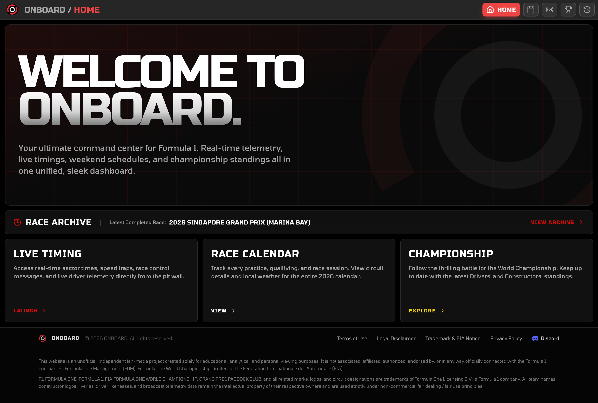
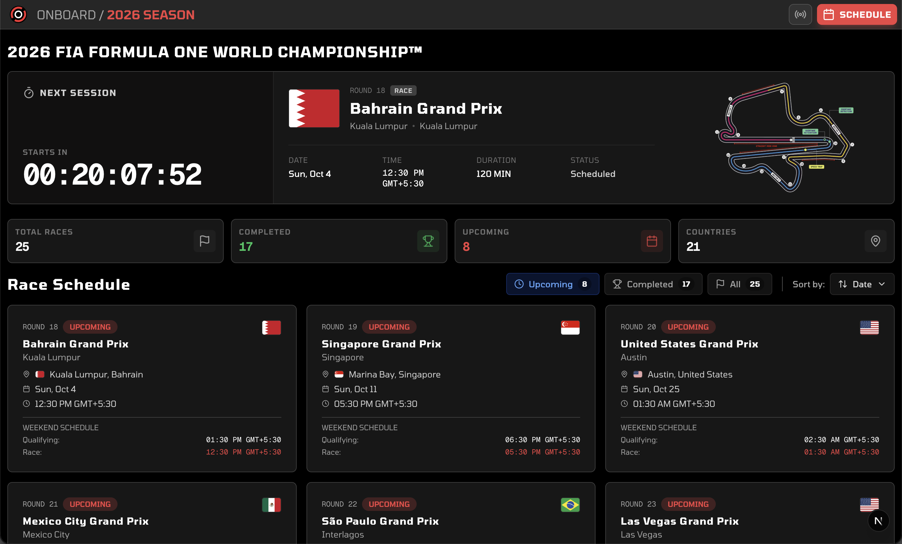
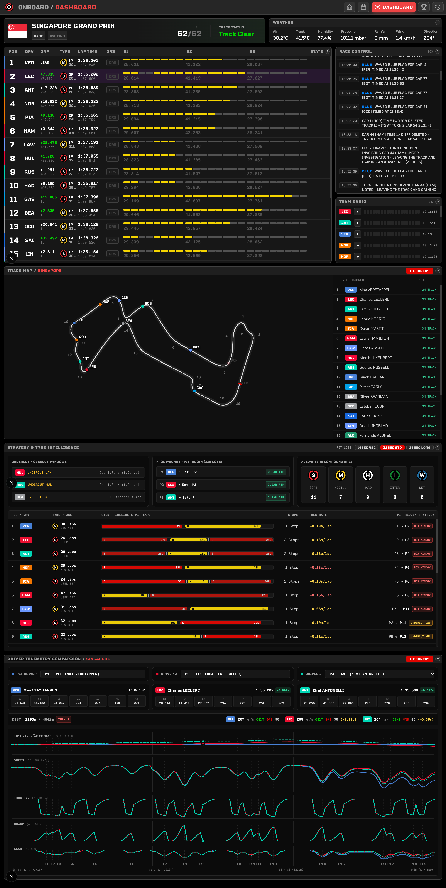
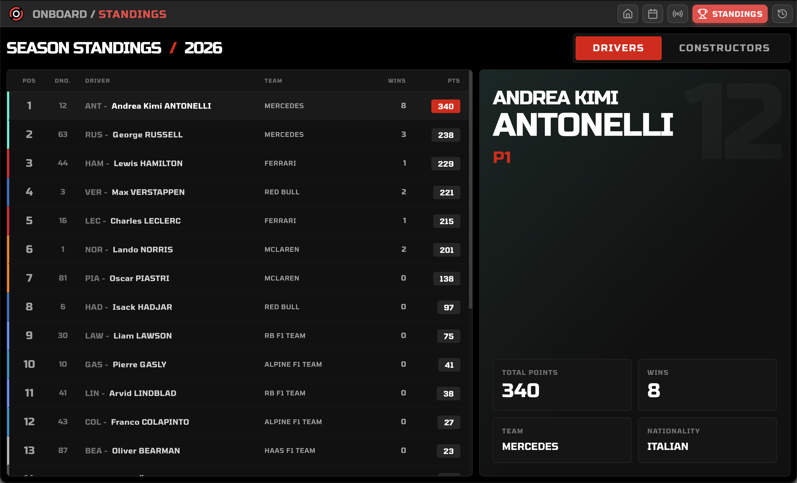
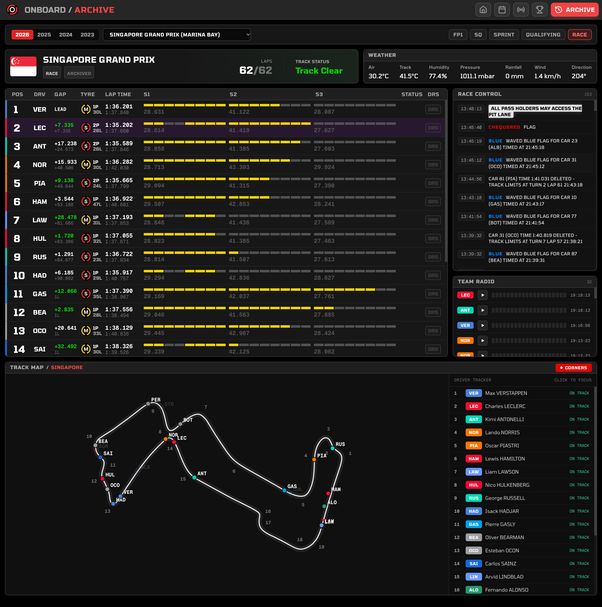

# ONBOARD

**ONBOARD** is a sleek, ultra-modern F1 telemetry and scheduling dashboard. Designed with an industry-grade glassmorphic UI, it hooks directly into official Formula 1 live data streams to deliver real-time race timing without needing to refresh the page.

### Features

- **Live Telemetry & Dashboard:** Streams live lap times, sectors, speeds, track status, and pit stops instantly using Server-Sent Events (SSE).
- **Race Schedule & Calendar:** Automatically fetches the 2026 Racing Calendar using the OpenF1 API, complete with detailed circuit track maps, session schedules, and local timezone conversion.
- **Championship Standings:** Dynamic 60/40 dashboard featuring driver and constructor standings with interactive typographic details and official F1 team colors.
- **Historical Race Archive:** Comprehensive archive of past Formula 1 race weekends, completed sessions, and Grand Prix results.
- **Unified Design Language:** Built with a dark-mode frosted-glass aesthetic, official F1 typography, and high-performance components.
- **Polyglot Monorepo:** Structured as an industry-standard monorepo with a Next.js (TypeScript) frontend communicating with a FastAPI (Python) backend orchestrator.

---

## Previews

### Home Dashboard
A high-level command center with quick navigation cards, upcoming race countdown, and season status at a glance.

### Race Schedule & Calendar
Keep track of upcoming sessions with a beautiful, automatically updating schedule featuring detailed circuit maps, weekend timetables, and race countdowns.

### Live Race Dashboard
Watch telemetry roll in live. The dashboard displays lap counts, sector deltas, speed traps, race control messages, and real-time tire compound strategies.

### Championship Standings
A beautifully crafted 60/40 interactive dashboard to explore the current Driver and Constructor championship standings with real-time point gaps.

### Race Archive
Explore past Grand Prix weekends, session breakdowns, race winners, and historical race records.

